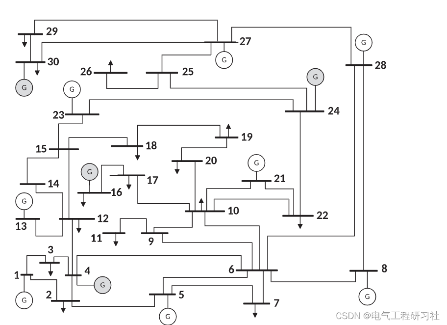
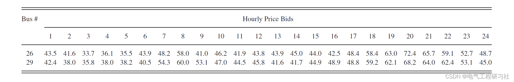
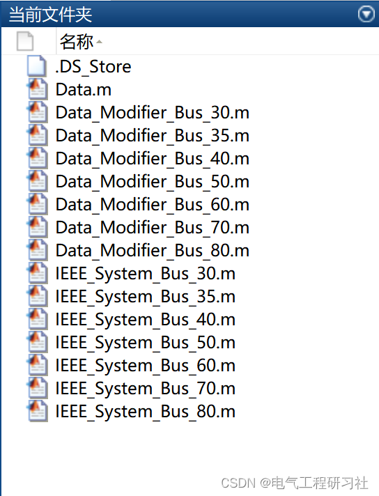
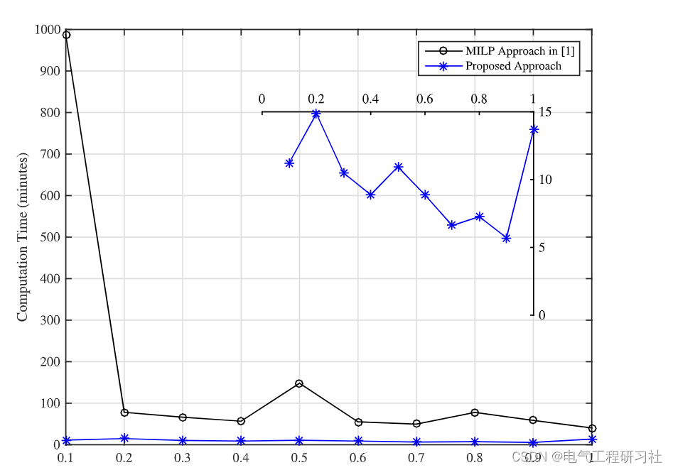
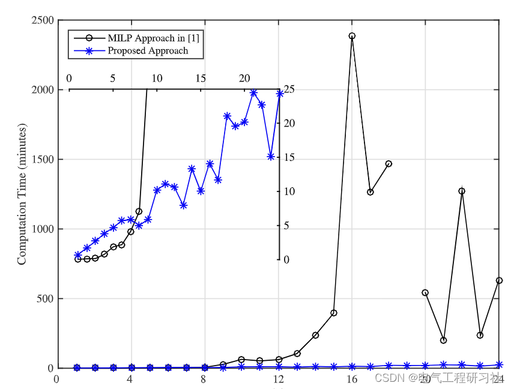

# Node Power Market Producer's Battle Strategies Bidding: Convex Slack Method (Matlab Code Implementation)

See Part 4 for the detailed mathematical model and its explanation.
3 Case Studies and Simulation Results
The IEEE 30-node test system considered in the case study. The generators in the power generation company are highlighted in gray.
Edited
Edited
Edited
Edited
4 Matlab and Detailed Article Explanation
This article only showcases a portion of the code, with all the code and detailed articles available here:
%% IEEE30 node data\nThematrix=[1           1       2      0.06           130 0.9783 0.0217\n2 1 3 0.19 130 0.9841 0.0159\n3 2 4 0.17 65 0.9532 0.0468\n4 3 4 0.04 130 0.9172 0.0828\n5 2 5 0.20 130 0.9786 0.0214\n6 2 6 0.18 65 0.9497 0.0503\n7 4 6 0.04 90 0.9828 0.0172\n8 5 7 0.12 70 0.9760 0.0240\n9 6 7 0.08 130 0.9211 0.0789\n10 6 8 0.04 32 0.9494 0.0506\n11 6 9 0.21 65 0.9494 0.0506\n12 6 10 0.56 32 0.9211 0.0789\n13 9 11 0.21 65 0.9535 0.0465\n14 9 10 0.11 65 0.9509 0.0491\n15 4 12 0.26 65 0.9660 0.0340\n16 12 13 0.14 65 0.9838 0.0162\n17 12 14 0.26 32 0.9754 0.0246\n18 12 15 0.13 32 0.9598 0.0402\n19 12 16 0.20 32 0.9510 0.0490\n20 14 15 0.20 16 0.9494 0.0506\n21 16 17 0.19 16 0.9494 0.0506\n22 15 18 0.22 16 0.9236 0.0764\n23 18 19 0.13 16 0.9514 0.0486\n24 19 20 0.07 32 0.9509 0.0491\n25 10 20 0.21 32 0.9666 0.0334\n26 10 17 0.08 32 0.9824 0.0176\n27 10 21 0.07 32 0.9786 0.0214\n28 10 22 0.15 32 0.9612 0.0388\n29 21 22 0.02 32 0.9462 0.0538\n30 15 23 0.20 16 0.9498 0.0502\n31 22 24 0.18 16 0.9506 0.0494\n32 23 24 0.27 16 0.9181 0.0819\n33 24 25 0.33 16 0.9483 0.0517\n34 25 26 0.38 16 0.9537 0.0463\n35 25 27 0.21 16 0.9733 0.0267\n36 27 28 0.40 65 0.9818 0.0182\n37 27 29 0.42 16 0.9808 0.0192\n38 27 30 0.60 16 0.9564 0.0436\n39 29 30 0.45 16 0.9537 0.0463\n40 8 28 0.20 32 0.9537 0.0463\n41 6 28 0.06 32 0.9536 0.0464 ];\n  
5 Conclusions Innovative methods for solving the strategic tendering problem in node electricity markets are proposed. Without loss of generality, we focus on producer strategic tendering cases. Unlike the state-of-the-art solution to recast the strategic bidding problem as MILP, the method presented in this paper is based on convex programming.
Despite the significant leap in solving strategic tendering issues for node electricity markets compared to state-of-the-art MILP-based methods, the proposed method still faces some limitations that can be addressed in future work. For instance, the proposed method seems to handle the increase in slot and random scenario counts well. However, it still cannot fully cope with the increase in node counts. In fact, due to the standard MILP-based methods needing a long time to converge, which provides us with a comparative reference, the results of our method in large networks are not yet clear. Another interesting direction for future work is to obtain the analytical performance bounds of the proposed method, i.e., optimality and computational time.Finally, one potential limitation of our approach is its potential sensitivity to the parameter choices made in lines 4 and 11 of Algorithm 1. These choices affect the number of iterations, the execution time per iteration, and the optimality of the final bidding solution. Knowing that the results presented in this paper are based on fixed pre-determined choices for the initial values and step size, developing methods to systematically select these values would be interesting.
6 References
[1] Sun Quan, Li Junxiang. Multi-energy complementary optimization strategy for power producers based on cooperative game [J]. Industrial Engineering, 2020, 23(03): 84-90.
[2] Li Fang. Analysis of load forecasting's impact on the electricity market competition [D]. Zhengzhou University, 2013.
[3] M. Ghamkhari, A. Sadeghi-Mobarakeh and H. Mohsenian-Rad, "Strategic Bidding for Producers in Nodal Electricity Markets: A Convex Relaxation Approach," in IEEE Transactions on Power Systems, vol. 32, no. 3, pp. 2324-2336, May 2017, doi: 10.1109/TPWRS.2016.2595593.
7 End Note

## Images

<!-- PAYMENT_BLOCK -->

## Get this dataset

- Payment link (Stripe): [Buy now](https://buy.stripe.com/3cs8yP7sY87d0vu9AB)
- Payment QR code: 

<!-- /PAYMENT_BLOCK -->
